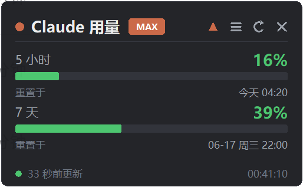
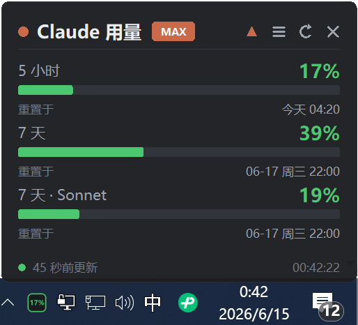
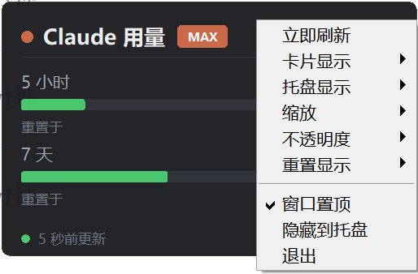

# AI Usage Assistant (Claude / Codex)

A tiny, always-on-top desktop card for **Windows, macOS, and Linux** that shows your **Claude Code** and **OpenAI Codex** usage limits in real time — the 5-hour and 7-day / weekly rolling windows (plus per-model windows such as Claude's 7-day Sonnet / Opus), each with its **reset time in your local timezone**. Show **both sources at once, or just one**. Includes a system-tray indicator (on macOS: a native menu-bar item showing the live %).

It does **not** bypass any limit — it just makes the official numbers visible so you can pace yourself.

> **Refreshes without the terminal.** If you use only the **Claude desktop app / Cowork**, you've probably hit "the local token expired, usage won't refresh" — because the card read only the CLI's credential file, and if you never run the CLI, nothing keeps that file fresh. The card now **reuses the desktop app's continuously-refreshed login token** (read-only, decrypted locally) and **auto-refreshes the CLI credential via its refreshToken** when needed. **Result: usage keeps refreshing without ever going back to `claude` in a terminal.**

English | [简体中文](README.zh-CN.md)

<p align="center">
  <br>
  <sub>The live card: 5-hour / 7-day / per-model windows, color-coded, each with its real reset time in your local timezone.</sub>
</p>

<p align="center">
  
  &nbsp;&nbsp;
  
</p>
<p align="center">
  <sub><b>Left:</b> the tray icon shows your chosen window's % right in the taskbar (the green <b>17%</b> at the bottom-left), and the card can list every window your account exposes — here 5-hour, 7-day, and 7-day · Sonnet. &nbsp;·&nbsp; <b>Right:</b> the menu lets you toggle <b>each window on the card individually</b> and pick <b>which one the tray reflects</b>.</sub>
</p>

## Features

- **Claude and Codex together** — show **both sources at once, or pick just one** (toggle in the menu). With multiple sources the card splits into per-source sections, each with its own plan badge (e.g. Claude `MAX`, Codex `PRO LITE`).
- **No terminal login, tokens don't go stale** — prefers the **Claude desktop app's** continuously-refreshed token; when using the CLI credential it **auto-refreshes via refreshToken and writes it back**. Codex works the same way (reads `~/.codex/auth.json` and auto-refreshes). All local, read-only against your existing login.
- **Live 5-hour & 7-day (weekly) usage** (and any other windows your account exposes), color-coded green / amber / red.
- **Real reset time, your timezone** — shown as a local clock like `今天 04:19` / `06-17 21:59`, derived from your system timezone (UTC+8, UTC+7, …) automatically. A live system clock sits in the footer.
- **System-tray icon** showing a chosen window's percentage with a `%` sign (default: Claude 5-hour). Left-click toggles the card; hover for a full breakdown.
- **Frameless, draggable, always-on-top card.** Resize by mouse-wheel, by dragging the window edges/corners, or via the menu.
- **Menu** (right-click or the `☰` button): **pick data sources** (Claude / Codex), **show or hide each window individually**, pick **which one the tray reflects**, plus zoom, opacity, and reset-display mode (clock vs. countdown).
- Remembers position, size, opacity, sources, and preferences. **Single-instance guard.** Optional **autostart**.
- **Cross-platform** — one file runs on Windows, macOS, and Linux; the transparent look adapts per OS.
- **Native on macOS** — the live % sits in the **menu bar** as crisp colored text (not a blurry 22-px bitmap), the Dock icon is hidden like a real menu-bar utility, the pinned card **follows you across Spaces and over full-screen apps**, right-click works with two-finger tap / Control-click, and `⌘Q` / logout quit cleanly.
- **Lightweight** — only the parts that change are redrawn each second (~10× less CPU than before), background updates wake the UI through an event pipe instead of polling, credentials and the desktop-token decryption are cached, and Claude + Codex are fetched in parallel.
- **One-click autostart** — tick **Start at login** in the menu (Windows Run key / macOS LaunchAgent / Linux autostart entry).
- Pure standard-library **tkinter** UI — no heavy UI framework. A single file, fully auditable.

## Where the token comes from · why it stops expiring

The card only uses the login state **already on your machine**, picking whichever copy is freshest so you don't have to think about it:

**Claude** (cheapest valid source first):
1. **CLI credential** `~/.claude/.credentials.json` (or the **macOS Keychain**) — used as-is while it's valid; cached in memory, so a refresh costs one `stat`.
2. **Desktop-app token** — reads the OAuth cache in the Claude desktop app / Cowork `config.json` and **decrypts it locally** with the OS's own crypto: Windows DPAPI + BCrypt, macOS CommonCrypto (both via pure `ctypes`, no extra dependency); Linux needs `cryptography`. The desktop app keeps this refreshed, so it's **always alive** — this is what makes "refreshes even when you only use the desktop app" work.
3. **Auto-refresh** — if neither is valid, the CLI credential is **refreshed via its refreshToken and written back** (atomic write, `0600` perms; Keychain writes go through `security -i` on stdin so the token never shows up in the process list).

**Codex:** reads `~/.codex/auth.json` (ChatGPT login mode); when near expiry or rejected, **auto-refreshes via its refreshToken and writes it back**.

- The token goes **only** in the `Authorization` header: Claude only to **`api.anthropic.com`**, Codex only to **`chatgpt.com`** — the same calls their official clients make.
- **No telemetry, no third-party servers.** Nothing is written out, cached, or uploaded anywhere, except refreshing **your own** credential files and a local `card_state.json` holding UI preferences (it contains **no** credentials).
- Decrypting the desktop token is **entirely local** and reads only what your current Windows/macOS user is already entitled to decrypt (the same protection the OS gives the desktop app); it never touches, rewrites, or uploads it.
- **macOS:** the first time the card reads the desktop token, macOS asks whether `security` may access **"Claude Safe Storage"** — choose **Always Allow** to not be asked again (choose Deny and the card simply sticks to the CLI credential).
- It only **displays** official usage; it does **not** bypass, modify, or work around any limit.
- All of it lives in [`quota_card.py`](quota_card.py) — read every line.

## Disclaimer

This tool reads usage from `https://api.anthropic.com/api/oauth/usage` (Claude) and `https://chatgpt.com/backend-api/wham/usage` (Codex) — both **undocumented internal endpoints** used by their respective clients. Neither is a public/official API, and **either may change or stop working at any time**. Endpoint URLs and field names are kept as constants near the top of `quota_card.py` so a fix is a one-line change. This project is **not affiliated with or endorsed by Anthropic or OpenAI**.

## Platform support

|  | Windows | macOS | Linux |
|---|:---:|:---:|:---:|
| Live usage & data | ✅ | ✅ (file or Keychain) | ✅ |
| Desktop-token reuse, zero extra deps | ✅ DPAPI + BCrypt | ✅ CommonCrypto | ▢ needs `cryptography` |
| Transparent rounded card | ✅ color-key | ✅ `-transparent` + `systemTransparent` | ▢ opaque card (square corners) |
| System tray | ✅ % icon | ✅ menu-bar % text, no Dock icon | ✅ with a tray host |
| Card on all desktops / over full-screen apps | — | ✅ when pinned | — |
| Right-click menu | ✅ | ✅ right-click / two-finger tap / Control-click | ✅ |
| Start at login (menu toggle) | ✅ Run key | ✅ LaunchAgent | ✅ `~/.config/autostart` |
| High-DPI / Retina scaling | ✅ | ✅ | ✅ |
| Single-instance guard | ✅ mutex | ✅ file lock | ✅ file lock |

One file, no per-OS build step. On Linux the card falls back to an opaque (square-cornered) look because X11 has no color-key transparency — everything else works the same. Set `QUOTA_CARD_OPAQUE=1` to force that opaque look on any OS.

## Requirements

- **Windows 10/11, macOS, or Linux**
- Python 3.10+ with **tkinter (Tk 8.6+)** — on macOS use the [python.org installer](https://www.python.org/downloads/macos/) (bundles Tk) or Homebrew `brew install python-tk@3.12`; avoid Apple's `/usr/bin/python3` (outdated Tk)
- [`requests`](https://pypi.org/project/requests/) (required)
- [`pystray`](https://pypi.org/project/pystray/) + [`Pillow`](https://pypi.org/project/pillow/) (optional — for the system tray; the app degrades to card-only if missing)
- **Claude:** signed in to Claude at least once — **the desktop app alone is enough**, or a terminal `claude` login (token in `~/.claude/.credentials.json` / macOS Keychain).
- **Codex (optional):** signed in to OpenAI Codex (`codex` login → `~/.codex/auth.json`). No Codex? Just leave only Claude ticked in the menu.
- **Desktop-token decryption (optional enhancement):** works out of the box on Windows and macOS (system crypto, no extra dependency); on Linux, `pip install cryptography` enables reading the desktop token, otherwise it falls back to the CLI credential.
- **Linux:** a compositing window manager (the default on GNOME/KDE) for the translucency; the tray needs a system-tray / AppIndicator host.

## Install & run

```sh
pip install -r requirements.txt      # = requests pystray pillow

python quota_card.py     # Windows
python3 quota_card.py    # macOS / Linux
```

- **Windows:** or double-click **`启动卡片.bat`** (launches with no console window).
- **macOS:** or double-click **`启动卡片.command`** in Finder (runs in the background; you can close the Terminal window it opens).
- **macOS / Linux:** or run **`./start.sh`** (`--detach` to background it). It picks a Python that actually has Tk 8.6+ and `requests`, and tells you what to install if none does. Override with `QUOTA_CARD_PYTHON=/path/to/python3`.
- First time on macOS/Linux, if the scripts aren't executable: `chmod +x start.sh 启动卡片.command`.

Verify the data pull without opening the UI (add `--check`):

```sh
python quota_card.py --check     # macOS/Linux: python3 quota_card.py --check
```

## Deploy from scratch

1. Install **Python 3.10+** — [python.org](https://www.python.org/downloads/) (on Windows tick **"Add python.exe to PATH"**; on macOS/Linux it's often preinstalled, or use Homebrew / your package manager).
2. Clone the repo and enter it:
   ```sh
   git clone https://github.com/huanchong-99/claude-usage-assistant
   cd claude-usage-assistant
   ```
3. Install dependencies:
   ```sh
   pip install -r requirements.txt
   ```
4. Make sure you have signed in to **Claude** at least once — the **desktop app alone is enough**, or a terminal `claude` login. *(Optional: sign in to **Codex** with `codex` for the second source.)*
5. Run it:
   ```sh
   python quota_card.py        # Windows  (or double-click 启动卡片.bat)
   python3 quota_card.py       # macOS / Linux  (or ./start.sh; macOS: double-click 启动卡片.command)
   ```
6. *(Optional)* Start at login — tick **Start at login** in the menu, or run `python3 quota_card.py --autostart on`.

## One-paste AI setup

Don't want to do it by hand? Paste the block below to an AI coding assistant (e.g. **Claude Code**) and it will set everything up for you:

```text
When you read this, you are an AI coding assistant. Please deploy "AI Usage Assistant (Claude / Codex)" on this machine (it supports Windows, macOS, and Linux — detect the OS first):
1. git clone https://github.com/huanchong-99/claude-usage-assistant and cd into the folder.
2. Detect a Python 3.10+ that has tkinter (Tk 8.6+) — on macOS prefer the python.org build or Homebrew python + python-tk, not /usr/bin/python3 — and install dependencies with it: python3 -m pip install -r requirements.txt (on Linux also cryptography if I want the desktop token read).
3. Confirm I have signed in to Claude (the Claude desktop app is enough, or a terminal `claude` login; token in ~/.claude/.credentials.json or the macOS Keychain). If I also use OpenAI Codex, confirm I'm logged in (`codex` → ~/.codex/auth.json).
4. Run the app (python quota_card.py on Windows, python3 quota_card.py on macOS/Linux) and verify the card shows my usage; if it errors, diagnose and fix it. You can run `python quota_card.py --check` for a quick self-test.
5. Ask whether I want it to start automatically at login; if yes, run it once with --autostart on (using the same Python), which registers it the right way for my OS.
Report back in my language when done.
```

## Controls

- **Drag** the card to move it (position is remembered).
- **Mouse-wheel** to zoom · **drag window edges/corners** to resize · **Ctrl + wheel** (macOS: also **⌘ + scroll**) to fine-tune opacity.
- **Top bar:** `▲` keep-on-top · `☰` menu · `↻` refresh · `✕` quit.
- **Menu** (right-click or `☰`; macOS: also two-finger tap / Control-click): Refresh · **Data sources** (tick Claude / Codex — multi-select) · **Card items** (show or hide each window) · **Tray item** (which window's % the tray shows) · Zoom · Opacity · Reset display · Keep on top · **Start at login** · Hide to tray · Quit.
- **Tray icon:** shows the selected window's `%`; left-click toggles the card; right-click for the menu. **macOS:** the % is shown as colored text in the menu bar — click it for Show/Hide card · Refresh · Move card back on screen · Quit.
- Lost the card after unplugging a monitor? It's moved back on screen automatically at startup, or use **Move card back on screen** in the tray / menu-bar menu.

Bar colors: green `< 50%`, amber `50–80%`, red `≥ 80%`.

## Configuration

Constants near the top of `quota_card.py`:

- `REFRESH_INTERVAL` — auto-refresh seconds (default `60`).
- `API_URL_USAGE` (Claude), `CODEX_USAGE_URL` (Codex), and the field names — edit here if an endpoint ever changes.
- `CLAUDE_TOKEN_URLS` / `CODEX_TOKEN_URL` — the OAuth endpoints used for auto-refresh.

Preferences (position, zoom, opacity, sources, shown items, tray item, reset mode) are saved to `card_state.json`.

**Environment variables:**

- `QUOTA_CARD_OPAQUE=1` — force an opaque, square-cornered card on any OS (handy on Linux/macOS if the transparent corners ever render oddly).
- `QUOTA_CARD_DOCK=1` — macOS: keep the Dock icon (by default it's hidden while the menu-bar item is available).
- `QUOTA_CARD_PYTHON=/path/to/python3` — which interpreter `start.sh` / `启动卡片.command` should use.
- `CLAUDE_CONFIG_DIR` — if you point Claude Code at a custom config dir, the app honors it too.
- `CODEX_HOME` — if you point Codex at a custom config dir, the app honors it too (default `~/.codex`).

## Autostart (optional)

Tick **Start at login** in the menu, or from a terminal (use the same Python you run the card with):

```sh
python3 quota_card.py --autostart on     # off to remove
```

It registers the current interpreter + script path the native way for each OS:

- **Windows:** `HKCU\Software\Microsoft\Windows\CurrentVersion\Run` → `AIUsageCard` (runs with `pythonw.exe`, no console).
- **macOS:** `~/Library/LaunchAgents/io.github.huanchong-99.ai-usage-card.plist` (no Terminal window; macOS may show a one-time "Background Items Added" notice).
- **Linux:** `~/.config/autostart/ai-usage-card.desktop`.

If you move the folder or switch Python, toggle it off and on again so the stored path is updated.

## Friend Links

- [LINUX DO](https://linux.do/) — a community for developers and tech enthusiasts.

## Credits

- Data approach referenced from [jens-duttke/usage-monitor-for-claude](https://github.com/jens-duttke/usage-monitor-for-claude).
- The official `rate_limits` field is documented in the [Claude Code status line docs](https://code.claude.com/docs/en/statusline).

## License

[MIT](LICENSE)
