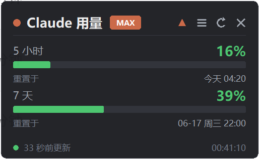
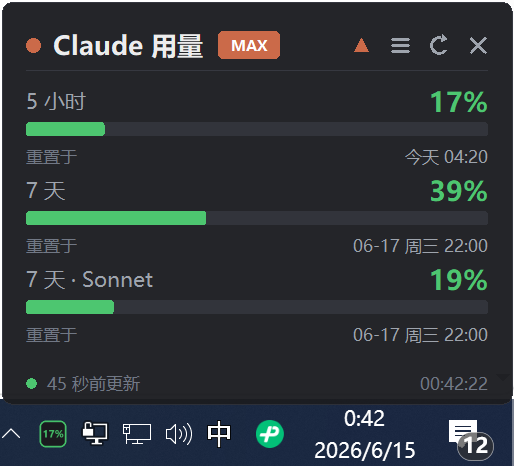
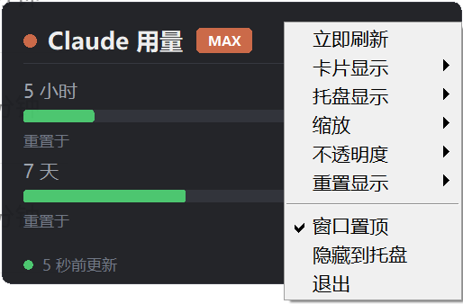

# AI Usage Assistant(Claude / Codex 用量助手)

一个 **Windows / macOS / Linux** 桌面小卡片,常驻置顶,**实时**显示你的 **Claude Code** 与 **OpenAI Codex** 限额使用情况——5 小时与 7 天 / 每周滚动窗口(以及账号存在的按模型窗口,如 Claude 的 7 天 Sonnet / Opus),并按**系统本地时区**显示每个窗口的**实际重置时刻**。两个数据源**可同时显示,也可只留其一**。附带系统托盘图标(macOS 上为原生菜单栏项,直接显示实时百分比)。

它**不绕过任何限额**,只是把官方的用量数字显示出来,方便你掌握节奏。

> **不用终端也能刷新。** 只用 **Claude 桌面版 / Cowork** 的用户,过去常遇到"本地 token 过期、额度刷不出来"——因为卡片只读 CLI 的凭证文件,而你不跑 CLI,那份文件就没人续期。现在卡片会**直接复用桌面版持续自动续期的登录令牌**(本地只读、就地解密),并在需要时**用 refreshToken 自动续期** CLI 凭证。**结果:不用再回终端 `claude` 登录,额度也能一直刷新。**

[English](README.md) | 简体中文

<p align="center">
  <br>
  <sub>实时卡片:5 小时 / 7 天 / 按模型窗口,按用量变色,每个窗口都按本地时区显示真实重置时刻。</sub>
</p>

<p align="center">
  
  &nbsp;&nbsp;
  
</p>
<p align="center">
  <sub><b>左:</b>托盘图标把所选窗口的百分比直接显示在任务栏上(左下角绿色 <b>17%</b>),卡片可列出账号存在的全部窗口——图中为 5 小时、7 天、7 天 · Sonnet。&nbsp;·&nbsp; <b>右:</b>菜单里可<b>逐个开关卡片上的每个窗口</b>,并选择<b>托盘显示哪一个</b>。</sub>
</p>

## 功能

- **同时支持 Claude 与 Codex** —— 两个数据源可**一起显示、也可只选其一**(菜单里勾选)。多源时卡片按数据源分节,各自带套餐徽标(如 Claude `MAX`、Codex `PRO LITE`)。
- **免终端登录、令牌不再过期** —— 优先复用 **Claude 桌面版**持续自动续期的登录令牌;CLI 凭证临期时也会**自动用 refreshToken 续期并写回**。Codex 同理(读 `~/.codex/auth.json` 并自动续期)。全过程本地完成,只读你已有的登录态。
- **实时 5 小时 / 7 天(每周)用量**(及账号存在的其它窗口),按用量绿 / 黄 / 红变色。
- **按系统时区显示真实重置时刻**——形如 `今天 04:19` / `06-17 21:59`,根据系统时区(东八区、东七区……)自动换算;底部还有一个实时系统时钟。
- **系统托盘图标**:白色圆角底 + 按用量变色的大号数字,深色 / 浅色任务栏上都清晰(默认 Claude 5 小时);左键单击显示/隐藏卡片,悬停查看全部明细。支持 StatusNotifierItem 的 Linux 桌面(如 KDE)使用原生托盘,左键同样可以切换卡片。
- **无边框、可拖动、置顶**;支持**滚轮缩放 / 拖动窗口边缘缩放 / 菜单选档位**。
- **菜单**(右键或 `☰` 按钮):**选择数据源**(Claude / Codex),**逐个开关卡片上的每个窗口**,选择**托盘显示哪一个**,以及缩放、不透明度、重置显示方式(时刻 / 倒计时)。
- 记忆位置、大小、不透明度、数据源与偏好;**单实例保护**;可选**开机自启**。
- **全平台** —— 同一份代码在 Windows / macOS / Linux 上运行;透明效果按系统自适应。
- **macOS 原生体验** —— 百分比以**彩色文字显示在菜单栏**(清晰锐利,不再是被缩成 22px 的模糊位图);像原生菜单栏小工具一样**隐藏 Dock 图标**;置顶时卡片**跟随你切换所有桌面(Spaces)、可浮在全屏 App 之上**;右键 / 双指轻点 / Control+单击 都能开菜单;`⌘Q`、注销、关机都会正常保存退出。
- **轻量省电** —— 每秒只重绘变化的几处文字(CPU 占用约为原来的 1/10);后台数据通过事件管道唤醒界面而非定时轮询;凭证与桌面版令牌解密结果都有缓存;Claude 与 Codex 并发拉取。
- **一键开机自启** —— 菜单里勾选 **开机自启** 即可(Windows 注册表 Run / macOS LaunchAgent / Linux autostart)。
- **macOS / Linux 应用图标** —— `./start.sh --install-app` 生成真正的应用:macOS 可从 Spotlight / 启动台 / Dock 打开,Linux 出现在应用菜单里。再次打开会把正在运行的卡片调到前台。
- 界面使用 Python 自带 **tkinter**,无重型 UI 框架;一个主文件(外加可选的 Linux 原生托盘 `tray_sni.py`),可逐行审计。

## 令牌从哪来 · 为什么不再过期

卡片只用你**本机已有的登录态**,按"哪份最新鲜"自动挑选,你不必操心:

**Claude**(按开销从低到高,取第一份有效的):
1. **CLI 凭证** `~/.claude/.credentials.json`(或 **macOS 钥匙串**)—— 有效期内直接用;内存缓存,每次刷新只需一次 `stat`。
2. **桌面版令牌** —— 读 Claude 桌面版 / Cowork 的 `config.json` 里的 OAuth 缓存(Windows 上经典安装版与**微软商店 / MSIX 版**均支持),用**系统自带加解密就地解密**:Windows 用 DPAPI + BCrypt,macOS 用 CommonCrypto(均为纯 `ctypes`、无额外依赖);Linux 需装 `cryptography`。桌面版会自己不断续期,所以这份**永远是活的**——这正是"只用桌面版也能刷新"的关键。
3. **自动续期** —— 两者都不可用时,**用 refreshToken 续期 CLI 凭证并写回**(原子写、`0600` 权限;写回钥匙串时经 `security -i` 的标准输入传递,令牌不会出现在进程列表里)。

**Codex:** 读 `~/.codex/auth.json`(ChatGPT 登录模式),临期或被拒时**自动用 refreshToken 续期并写回**。

- 令牌**只**放进 `Authorization` 头:Claude 只发往 **`api.anthropic.com`**、Codex 只发往 **`chatgpt.com`**——与两者官方客户端的请求完全一致。
- **无遥测、无第三方服务器**;除续期时写回**你自己的**凭证文件、以及保存界面偏好的本地 `card_state.json`(其中**不含**任何凭证)之外,不向任何地方写出、缓存或上传。
- 解密桌面版令牌**全程本地**、只读你当前 Windows/macOS 用户能解的内容(与系统给桌面版的保护同源);不触碰、不改写、不上传。
- **macOS:** 卡片第一次读取桌面版令牌时,系统会询问是否允许 `security` 访问钥匙串中的 **"Claude Safe Storage"**——选 **始终允许** 以后就不再询问(选拒绝则卡片只使用 CLI 凭证)。
- 它只**显示**官方用量,**不绕过、不修改、不规避**任何限额。
- 全部逻辑都在 [`quota_card.py`](quota_card.py)(Linux 原生托盘另见 [`tray_sni.py`](tray_sni.py)),可逐行审计。

## 免责声明

本工具从 `https://api.anthropic.com/api/oauth/usage`(Claude)与 `https://chatgpt.com/backend-api/wham/usage`(Codex)读取用量,二者都是各自客户端使用的**未公开内部接口**,并非公开/官方 API,**可能随时变动或失效**。接口地址与字段名以常量形式放在 `quota_card.py` 顶部,便于一行修复。本项目**与 Anthropic、OpenAI 均无任何关联,也未获其背书**。

## 平台支持

|  | Windows | macOS | Linux |
|---|:---:|:---:|:---:|
| 实时用量与数据 | ✅ | ✅(凭证文件或钥匙串) | ✅ |
| 复用桌面版令牌(零额外依赖) | ✅ DPAPI + BCrypt | ✅ CommonCrypto | ▢ 需 `cryptography` |
| 透明圆角卡片 | ✅ 色键 | ✅ `-transparent` + `systemTransparent` | ▢ 不透明卡片(方角) |
| 系统托盘 | ✅ 百分比图标 | ✅ 菜单栏彩色百分比、隐藏 Dock 图标 | ✅ 原生 SNI(左键切换卡片)· pystray 兜底 |
| 卡片在所有桌面 / 全屏 App 上可见 | — | ✅ 置顶时 | — |
| 右键菜单 | ✅ | ✅ 右键 / 双指轻点 / Control+单击 | ✅ |
| 开机自启(菜单一键开关) | ✅ 注册表 Run | ✅ LaunchAgent | ✅ `~/.config/autostart` |
| 高分屏 / Retina 缩放 | ✅ | ✅ | ✅ |
| 单实例保护 | ✅ 互斥量 | ✅ 文件锁 | ✅ 文件锁 |

无需按系统打包。Linux 上因 X11 没有色键透明,卡片退化为不透明(方角)外观,其余功能完全一致。设环境变量 `QUOTA_CARD_OPAQUE=1` 可在任意系统强制该不透明外观。

## 环境要求

- **Windows 10/11、macOS 或 Linux**
- Python 3.10+,且带 **tkinter(Tk 8.6+)** —— macOS 请用 [python.org 官方安装包](https://www.python.org/downloads/macos/)(自带 Tk)或 Homebrew `brew install python-tk@3.12`;不要用系统自带的 `/usr/bin/python3`(Tk 过旧)
- `requests`(必需)
- `pystray` + `Pillow`(可选,用于系统托盘;缺失时自动降级为仅卡片)
- **Claude:** 已登录过 Claude(桌面版,或终端 `claude` 登录 → 凭证在 `~/.claude/.credentials.json` / macOS 钥匙串)。**只用桌面版即可**,无需终端登录。
- **Codex(可选):** 已登录过 OpenAI Codex(`codex` 登录 → 凭证在 `~/.codex/auth.json`)。没装 Codex 就在菜单里只留 Claude。
- **桌面版令牌解密(可选增强):** Windows 与 macOS 开箱即用(系统自带加解密,无额外依赖);Linux 若要读桌面版令牌,装 `cryptography` 即可(`pip install cryptography`),否则回退到 CLI 凭证路径。
- **Linux:** 需要合成型窗口管理器(GNOME/KDE 默认即是)以实现半透明;托盘需要系统托盘 / StatusNotifierItem 宿主。*可选:* 装 PyGObject(`sudo apt install python3-gi` / `sudo dnf install python3-gobject`)启用原生托盘——左键切换卡片、中键立即刷新。

## 安装与运行

```sh
pip install -r requirements.txt      # 即 requests pystray pillow

python quota_card.py     # Windows
python3 quota_card.py    # macOS / Linux
```

- **Windows:** 或双击 **`启动卡片.bat`**(无控制台窗口启动)。
- **macOS:** 或在访达里双击 **`启动卡片.command`**(后台运行,弹出的终端窗口可直接关掉)。
- **macOS / Linux:** 或运行 **`./start.sh`**(加 `--detach` 后台运行)。它会优先检测项目的 `.venv/bin/python`(无需手动激活),再查找其它带 Tk 8.6+ 且装了 `requests` 的 Python;找不到时会告诉你该装什么。也可用 `QUOTA_CARD_PYTHON=/path/to/python3` 指定。
- macOS/Linux 首次若脚本不可执行:`chmod +x start.sh 启动卡片.command`。

macOS 上已有 `uv` 和带 Tk 的 `python3.12` 时,可以用独立环境安装。本项目的 `requirements-macos.lock` 固定了 2026-11-01 在 Apple Silicon / Python 3.12 上验证的依赖版本:

```sh
uv venv --python python3.12 --no-python-downloads --no-cache .venv
uv pip install --python .venv/bin/python --no-cache --only-binary :all: -r requirements-macos.lock
./start.sh
```

### 应用图标(macOS / Linux,可选)

生成一个像普通应用一样打开的入口:

```sh
./start.sh --install-app        # 移除用 --uninstall-app
```

- **macOS:** 生成 `~/Applications/AI 用量卡片.app`——可从 **Spotlight**、**启动台** 打开,或拖到 **Dock**。
- **Linux:** 在应用菜单 / 活动搜索里加入带图标的 **AI 用量卡片**。
- 卡片已在运行时再次打开,会把卡片调到前台(即使它正藏在托盘里),不会启动第二份。
- 入口记录的是当前的 Python 和项目路径——移动了项目文件夹或换了 Python,重新运行一次即可。

不开界面、仅拉取一次数据自检(加 `--check`):

```sh
python quota_card.py --check     # macOS/Linux:python3 quota_card.py --check
```

## 从零部署

1. 安装 **Python 3.10+** —— [python.org](https://www.python.org/downloads/)(Windows 安装时勾选 **“Add python.exe to PATH”**;macOS/Linux 通常已自带,或用 Homebrew / 包管理器安装)。
2. 克隆仓库并进入:
   ```sh
   git clone https://github.com/huanchong-99/claude-usage-assistant
   cd claude-usage-assistant
   ```
3. 安装依赖:
   ```sh
   pip install -r requirements.txt
   ```
4. 确认你已**登录过 Claude Code**(凭证在 `~/.claude/.credentials.json`,或 macOS 钥匙串里)。
5. 运行:
   ```sh
   python quota_card.py        # Windows(或双击 启动卡片.bat)
   python3 quota_card.py       # macOS / Linux(或 ./start.sh;macOS 可双击 启动卡片.command)
   ```
6. *(可选)* 开机自启 —— 菜单里勾选 **开机自启**,或运行 `python3 quota_card.py --autostart on`。

## 一句话让 AI 帮你部署

不想手动?把下面这段**直接粘贴给 AI 编程助手**(如 **Claude Code**),它就会自动帮你装好:

```text
当你读到这段话时,你是一名 AI 编程助手。请帮我在这台电脑上部署「AI Usage Assistant(Claude / Codex 用量助手)」(支持 Windows / macOS / Linux,请先判断我的系统):
1. 用 git 克隆仓库 https://github.com/huanchong-99/claude-usage-assistant 并进入该目录。
2. 检测一个带 tkinter(Tk 8.6+)的 Python 3.10+——macOS 优先用 python.org 官方版或 Homebrew python + python-tk,不要用 /usr/bin/python3——并用它安装依赖:python3 -m pip install -r requirements.txt(Linux 若想读桌面版令牌再加 cryptography)。
3. 确认我已登录过 Claude(用 Claude 桌面版即可,或终端 claude 登录;凭证在 ~/.claude/.credentials.json 或 macOS 钥匙串);若我也用 OpenAI Codex,确认我已 codex 登录(凭证在 ~/.codex/auth.json)。
4. 运行程序(Windows 用 python quota_card.py,macOS/Linux 用 python3 quota_card.py),确认卡片能正常显示用量;若报错请排查并修复。可先跑 python quota_card.py --check 快速自检。
5. 询问我是否需要开机自启;需要的话,用同一个 Python 运行一次 quota_card.py --autostart on,它会按我的系统用正确方式注册。
6. 如果是 macOS / Linux,询问我是否需要应用图标(Spotlight / 启动台 / Dock,或 Linux 应用菜单);需要的话运行 ./start.sh --install-app。
完成后用中文向我汇报结果。
```

## 操作

- **拖动**卡片移动位置(会记忆)。
- **滚轮**缩放 · **拖动窗口边缘/四角**缩放 · **Ctrl + 滚轮**(macOS 也可 **⌘ + 滚动**)微调不透明度。
- **顶栏:** `▲` 置顶 · `☰` 菜单 · `↻` 刷新 · `✕` 退出。**macOS:** 窗口按钮和其它 Mac 窗口一样在左上角,为红绿灯样式——红 = 退出,黄 = 隐藏到菜单栏(悬停显示 × / −);右侧不再有 `✕`。
- 卡片始终整体缩放——即使窗口被外部改了尺寸(系统、平铺式窗口管理器),内容也会跟着缩放,不会被裁掉。
- **菜单**(右键或 `☰`;macOS 也可双指轻点 / Control+单击):立即刷新 · **数据源**(勾选 Claude / Codex,可多选) · **卡片显示**(逐个显示或隐藏每个窗口) · **托盘显示**(托盘呈现哪个窗口的 %) · 缩放 · 不透明度 · 重置显示 · 窗口置顶 · **开机自启** · 隐藏到托盘 · 退出。
- **托盘图标:** 显示所选窗口的百分比(只显示数字,以便放大);左键单击显示/隐藏卡片;右键打开菜单;Linux 原生托盘中键 = 立即刷新。**macOS:** 百分比以彩色文字显示在菜单栏,点击弹出菜单:显示/隐藏卡片 · 立即刷新 · 卡片移回屏幕 · 退出。
- 拔掉外接显示器后卡片"不见了"?启动时会自动移回屏幕内;也可在托盘 / 菜单栏菜单里点 **卡片移回屏幕**。

颜色:绿 `< 50%`,黄 `50–80%`,红 `≥ 80%`。

## 配置

修改 `quota_card.py` 顶部常量:

- `REFRESH_INTERVAL` —— 自动刷新间隔(秒,默认 `60`)。
- `API_URL_USAGE`(Claude)、`CODEX_USAGE_URL`(Codex)及字段名 —— 接口若变动,改这里即可。
- `CLAUDE_TOKEN_URLS` / `CODEX_TOKEN_URL` —— 自动续期用的 OAuth 端点。

偏好(位置、缩放、不透明度、数据源、显示项、托盘项、重置方式)保存在 `card_state.json`。

**环境变量:**

- `QUOTA_CARD_OPAQUE=1` —— 在任意系统强制不透明、方角卡片(Linux/macOS 上若透明圆角显示异常时好用)。
- `QUOTA_CARD_DOCK=1` —— macOS:保留 Dock 图标(默认在菜单栏项可用时隐藏)。
- `QUOTA_CARD_PYTHON=/path/to/python3` —— 指定 `start.sh` / `启动卡片.command` 使用的解释器。
- `CLAUDE_CONFIG_DIR` —— 若你给 Claude Code 指定了自定义配置目录,本程序也会遵循。
- `CODEX_HOME` —— 若你给 Codex 指定了自定义配置目录,本程序也会遵循(默认 `~/.codex`)。

## 开机自启(可选)

在菜单里勾选 **开机自启**,或在终端运行(用你平时启动卡片的同一个 Python):

```sh
python3 quota_card.py --autostart on     # 关闭用 off
```

它会把当前解释器 + 脚本路径按各系统的原生方式注册:

- **Windows:** 注册表 `HKCU\Software\Microsoft\Windows\CurrentVersion\Run` → `AIUsageCard`(用 `pythonw.exe` 启动,无控制台窗口)。
- **macOS:** `~/Library/LaunchAgents/io.github.huanchong-99.ai-usage-card.plist`(无终端窗口;系统可能弹一次"已添加后台项目"提示)。
- **Linux:** `~/.config/autostart/ai-usage-card.desktop`。

若移动了项目文件夹或换了 Python,关掉再打开一次自启即可更新记录的路径。

## 友情链接

- [LINUX DO](https://linux.do/) —— 聚集开发者与技术爱好者的社区。

## 致谢

- 数据获取思路参考自 [jens-duttke/usage-monitor-for-claude](https://github.com/jens-duttke/usage-monitor-for-claude)。
- Linux 原生 StatusNotifierItem 托盘(`tray_sni.py`)由 [@zj243](https://github.com/zj243) 在 [#1](https://github.com/huanchong-99/claude-usage-assistant/pull/1) 贡献。
- 微软商店版支持与托盘图标可读性改进由 [@B-22](https://github.com/B-22) 在 [#2](https://github.com/huanchong-99/claude-usage-assistant/issues/2)、[#3](https://github.com/huanchong-99/claude-usage-assistant/issues/3) 提出。
- 官方 `rate_limits` 字段见 [Claude Code 状态行文档](https://code.claude.com/docs/en/statusline)。

## 许可证

[MIT](LICENSE)
